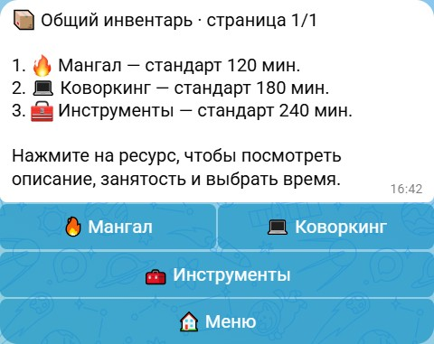
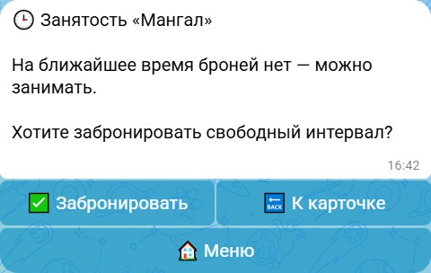
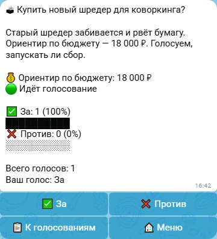
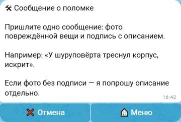

# Соседский ресурс

Командный прототип для хакатона «Умные города и дома». Жители посёлка могли бронировать общий инвентарь, сообщать о поломках и голосовать за покупки через ботов.

## Возможности

| Сценарий | Как работал |
| --- | --- |
| Бронирование | Проверка пересечений, залоги и предложение ближайшего свободного времени |
| Репутация и баллы | Стартовый баланс, штрафы, ограничения за поздний возврат и счётчик экономии |
| Общие покупки | Голосования и сбор баллов |
| Инициативы жителей | Создание собственных опросов |
| Администрирование | Управление инвентарём и обработка сообщений о поломках |

## Как был устроен проект

Боты ВКонтакте и MAX работали с общей базой данных SQLite. В репозитории их точки входа — [main.py](main.py) и [max_bot.py](max_bot.py). Telegram-бот тоже работал во время хакатона.

Хостинг остановлен, прежние токены выведены из использования. Сейчас боты офлайн. Для своего экземпляра понадобятся собственные токены и среда, в которой будут запущены процессы ботов.

## Telegram-бот на хакатоне


На архивных скриншотах можно посмотреть каталог, проверку занятости, результаты голосования и форму сообщения о поломке.

| Каталог инвентаря | Проверка занятости |
| --- | --- |
|  |  |

| Голосование за общую покупку | Сообщение о поломке |
| --- | --- |
|  |  |

## Запуск

Понадобится Python 3.12. Установите зависимости и запустите тесты бизнес-логики.

```bash
python -m pip install -r requirements.txt
python -m pytest
```

Задайте `VK_TOKEN` для ВКонтакте или `MAX_TOKEN` для MAX в локальном `.env`. Для общей базы запустите оба процесса с одним и тем же `DATABASE_URL`. Храните токены локально.

| Бот | Команда |
| --- | --- |
| ВКонтакте | `python main.py` |
| MAX | `python max_bot.py` |

## Технологии

Python 3.12, vkbottle, aiohttp, SQLAlchemy 2.0 Async, SQLite и pytest. Состояния диалога хранятся в базе.
